# Review design system: UI có đang là "AI slop" không?

Phạm vi: chỉ design system. Gồm token và Sass module trong `libs/ui`, các partial và atom/molecule/organism, UI dùng chung trong `apps/lms/src/app/shared` và `apps/lms/src/app/layout`, trang `/design-system`, và cách các màn hình đã chuyển dùng chúng. Báo cáo không sửa code UI. Đề xuất nằm ở §3, §5 và §6. Quy tắc để các lần sinh UI sau không lặp lại nằm ở [`docs/conventions/visual-design.md`](../conventions/visual-design.md).

Cách làm: đọc token, mixin, partial và component; chạy app trên mock backend (bật `mockBackend: true` để chụp, đã trả lại `false`); chụp ở 1280×800, theme BIDV chuẩn trừ khi ghi khác; đối chiếu với mockup trong `lms-mockup/`. Ngày 20/10/2026, nhánh `claude/lms-design-system-review-7342fb` tách từ `fd60883`.

Viết tắt đường dẫn: `ui/` = `libs/ui/src/styles/ui/`, `components/` = `libs/ui/src/styles/components/`, `global/` = `libs/ui/src/styles/global/`, `app/` = `apps/lms/src/app/`.

## 1. Kết luận

**Có. Đây là "AI slop có kỷ luật".**

Nền kỹ thuật tốt hơn mức thường gặp. Token khai báo một nơi, `ui.color(...)` làm build lỗi khi sai key, spec tương phản chạy cho mọi bảng màu ở cả chế độ sáng và tối, a11y được làm thật.

Vấn đề nằm ở ngôn ngữ thị giác: giải phẫu từng component và cách ghép chúng thành trang. Gần như mọi màn hình lặp lại bộ khuôn của dashboard SaaS do AI sinh ra:

- eyebrow chữ hoa trên mọi tiêu đề;
- icon đặt trong ô màu nhạt;
- lưới "tính năng" 3 cột;
- hero gradient có hoa văn mờ;
- sọc màu ở viền trái;
- badge dạng viên thuốc ở khắp nơi;
- ảnh bìa pastel với một icon ở giữa;
- chữ nào cũng semibold.

Người đã quen nhìn UI do AI làm sẽ nhận ra chỉ sau vài giây. Ngoài màu thương hiệu và font chữ, hiếm có quyết định nào cho thấy ai đó đã cân nhắc riêng cho một ngân hàng, cho đào tạo nội bộ, hay cho chữ tiếng Việt.

Chấm theo 18 dấu hiệu ở §2: **11 có, 4 một phần, 3 không**.

### Nguyên nhân gốc

1. **Mockup do AI sinh.** Dấu vết còn ngay trên giao diện. Mô tả mục Typography của `/design-system` ghi "Skill gợi ý cặp 'Financial Trust'" (`app/features/design-system/design-system/components/type-section/type-section.html:4`, ảnh 14). Đó là lời gợi ý của một công cụ sinh UI, lọt thẳng vào sản phẩm.
2. **Quy trình chuyển đổi bảo toàn slop.** `docs/migration/mockup-to-angular.md` coi mockup là spec cho cả "look" và yêu cầu kết quả có "same structure, copy, tokens and states". Port càng trung thành thì mẫu AI càng được giữ nguyên. Nhiều partial còn ghi rõ "ported from the mockup's `.badge` block".
3. **Theme chỉ thay áo.** Bốn bảng màu (BIDV chuẩn, Ngọc, Cobalt, Giấy) đổi màu, font, bo góc và texture nhưng giữ nguyên giải phẫu. Vì vậy dấu hiệu AI có mặt ở cả bốn (so ảnh 04 với 05, và ảnh 06, 12, 13). Cobalt và Giấy còn thêm thẩm mỹ AI riêng (§3.12).

### Tin tốt

Gốc của hầu hết dấu hiệu nằm trong khoảng 30 file của `libs/ui`, `app/shared` và `app/layout`, đa số chỉ cần sửa vài dòng. Theo bảng migration, 39/48 component đã xong nhưng mới 8/47 route được chuyển (2 xong, 6 đang làm). Sửa design system ngay bây giờ thì gần 40 màn hình còn lại hưởng lợi luôn. Để sau thì mỗi màn hình mới lại nhân bản các mẫu này, và sẽ phải sửa lại từng màn.

## 2. Bảng chấm 18 dấu hiệu

Bộ dấu hiệu tổng hợp từ các nhận xét phổ biến về UI do AI sinh. "Có" nghĩa là xuất hiện ở component dùng chung hoặc ở nhiều màn hình. "Một phần" nghĩa là có, nhưng nhẹ hoặc chỉ ở một chỗ.

| #   | Dấu hiệu                                          | Mức      | Bằng chứng chính                                                                                                                  | Mục   |
| --- | ------------------------------------------------- | -------- | --------------------------------------------------------------------------------------------------------------------------------- | ----- |
| 1   | Eyebrow (nhãn chữ hoa nhỏ, giãn chữ) trên tiêu đề | Có       | mixin `ui/_mixins.scss:85-90`, token màu riêng `ui/_tokens.scss:82`; cả 4 trang dùng page header đều có eyebrow                   | §3.1  |
| 2   | Icon đặt trong ô hoặc vòng tròn màu để trang trí  | Có       | `kpi.ts:51` (icon bắt buộc), `components/_kpi.scss:20-28`, `_list.scss:40-49`, `_dialog.scss:35-43`, `_empty.scss:32-39`          | §3.4  |
| 3   | Lưới "tính năng" 3 cột: icon, tiêu đề, mô tả      | Có       | `principles-section.html:5-12`; 3 gạch đầu dòng có icon ở trang đăng nhập (`login.html:19-26`)                                    | §3.4  |
| 4   | Màu trạng thái dùng để phân loại                  | Có       | `app/shared/status/role-badge.ts:9-12` (Quản trị gốc màu đỏ, Quản trị màu cảnh báo), `app/shared/course/required-mark.ts:9`       | §3.2  |
| 5   | Badge, pill tràn lan                              | Có       | hồ sơ: 4 badge trên một dòng và 13 chip quyền (ảnh 04); bảng người dùng: 2 pill và một link đỏ trên mỗi dòng (ảnh 03)             | §3.3  |
| 6   | Sọc màu ở viền trái                               | Có       | `components/_toast.scss:20`, `components/_tip.scss:7`, `app/layout/sidebar/sidebar.scss:126`                                      | §3.5  |
| 7   | Hero gradient kèm hoa văn mờ                      | Có       | `hero.scss:14-39`, `login.scss:33-37`; hero dashboard học viên của mockup (`lms-mockup/src/pages/learner.js:19-24`) đang chờ port | §3.6  |
| 8   | Ảnh bìa pastel với một icon ở giữa                | Có       | `course-card.html:2-11`, `course-card.scss:18-47`, 6 token `cover-*` ở `ui/_tokens.scss:44-49`                                    | §3.7  |
| 9   | Empty state căn giữa với vòng tròn icon           | Có       | `components/_empty.scss:32-39`, `empty.ts:42` (mặc định icon `inbox`); dùng cả cho trang placeholder (ảnh 02)                     | §3.4  |
| 10  | Một độ đậm cho mọi thứ                            | Có       | trong SCSS: 51 chỗ semibold, 7 medium, 2 regular; badge, nút, nhãn field, `th`, eyebrow đều 600                                   | §3.8  |
| 11  | Giọng văn AI                                      | Có       | slogan hai vế nối bằng gạch dài (`login.html:13`, hero `/design-system`), "Chào mừng trở lại" (`login.html:38`), dải chip tự khen | §3.13 |
| 12  | Nội dung trượt và mờ dần khi xuất hiện            | Một phần | keyframe `enter` trượt 8px (`global/_theme.scss:74-78`), gắn cho mọi empty state (`components/_empty.scss:6`)                     | §3.10 |
| 13  | Bo góc lẫn lộn, pill khắp nơi                     | Một phần | 8 khóa bán kính, 6 giá trị khác nhau (`ui/_tokens.scss:341-353`); badge bo tròn hẳn (`components/_badge.scss:10`)                 | §3.9  |
| 14  | Header kính mờ                                    | Một phần | `app/layout/header/header.scss:17`                                                                                                | §3.6  |
| 15  | Màu Tailwind mặc định lọt vào bảng màu            | Một phần | `#7c3aed` (violet-600) và `#b45309` (amber-700) trong bảng màu biểu đồ, `#ede9fe` (violet-100) cho `cover-database`               | §3.14 |
| 16  | Gradient tím hoặc indigo                          | Không    | BIDV không có; riêng hero của Cobalt (`#132a66` sang `#2b55b8`, `ui/_tokens.scss:565-566`) đã rất gần                             | §3.12 |
| 17  | Đổ bóng mềm, thẻ kính                             | Không    | thẻ phẳng, viền 1px                                                                                                               | §4    |
| 18  | Emoji trong UI, font Inter                        | Không    | Be Vietnam Pro và bộ icon Lucide                                                                                                  | §4    |

## 3. Phát hiện chi tiết

Mỗi mục gồm: hiện trạng, vì sao đó là dấu hiệu AI, đề xuất, và nơi cần sửa.

### 3.1 Eyebrow chữ hoa trên mọi tiêu đề

**Hiện trạng.** Mixin `ui.eyebrow` (`ui/_mixins.scss:85-90`) cho chữ 12px, semibold, giãn 0.08em, viết hoa. Nó có hẳn một token màu riêng là `eyebrow` (`ui/_tokens.scss:82`), và từng bảng màu lại ghi đè token này. Eyebrow xuất hiện ở:

- page header của cả 4 trang đã chuyển: `users.html:2`, `org.html:2`, `roles.html:2` cùng ghi "Tổ chức", `profile.html:3` ghi "Tài khoản";
- trang đăng nhập ("ĐĂNG NHẬP" ngay trên "Chào mừng trở lại") và trang đổi mật khẩu;
- thẻ khóa học, nhóm menu ở sidebar, tiêu đề cột bảng (`components/_table.scss:29`), nhãn menu (`components/_menu.scss:61`);
- hero và từng section của `/design-system` ("01", "02"…).

**Vì sao.** Eyebrow là mẫu của landing page, nơi nó dẫn mắt vào một tiêu đề lớn. Trong ứng dụng nội bộ nó chỉ nhắc lại thông tin đã có: "TỔ CHỨC" phía trên "Người dùng" chính là tên nhóm menu đang sáng ngay bên trái (ảnh 03).

Với tiếng Việt, chữ hoa cỡ nhỏ còn khó đọc. Dấu đặt trên chữ hoa (Ổ, Ứ, Ậ, Ể) bị nén ở 12px, và giãn chữ làm các âm tiết rời nhau. Kiểu chữ hoa nhỏ giãn rộng là thói quen của typography tiếng Anh, không hợp với tiếng Việt.

**Đề xuất.**

- Bỏ eyebrow khỏi page header. Sidebar và breadcrumb đã cho biết người dùng đang ở đâu. Trang sâu cần thêm ngữ cảnh thì dùng breadcrumb.
- Nhãn nhóm sidebar, `th`, nhãn menu: viết như câu thường (chỉ hoa chữ đầu), 13–14px, độ đậm medium (500), màu `text-muted`. Phân cấp bằng cỡ chữ và màu, không bằng chữ hoa.
- Chỉ giữ chữ hoa cho từ viết tắt thật (CIF, EOD, KPI) và mã khóa học như `NV-101`.
- Khi không còn chỗ dùng, xóa mixin `ui.eyebrow`, token `eyebrow` và tracking `wider`.

**Sửa ở đâu.** `ui/_mixins.scss:85-90`, `ui/_tokens.scss:82` cùng các bản ghi đè trong từng palette, `components/_page-header.scss:25-31`, `components/_table.scss:29`, `components/_menu.scss:61`, `app/layout/sidebar/sidebar.scss:80-81`, `app/shared/theme-controls/theme-controls.scss:12`, `app/shared/course/course-card.scss:69-74`, `app/features/auth/login/login.scss:124-125`, và thuộc tính `eyebrow=` ở 4 trang.

### 3.2 Màu trạng thái bị dùng để phân loại

**Hiện trạng.** `app/shared/status/role-badge.ts:9-12` gán màu theo vai trò: Quản trị viên gốc là `danger` (đỏ), Quản trị là `warning` (cam), Giảng viên là `info`, Học viên là `primary`. `app/shared/course/required-mark.ts:9` gán nhãn "Bắt buộc" màu `danger`. Kết quả: hồ sơ của quản trị gốc có badge đỏ ngay cạnh tên (ảnh 04), và thẻ khóa học nào cũng có một góc đỏ "Bắt buộc" (ảnh 11).

**Vì sao.** AI chọn màu cho đa dạng, không chọn theo nghĩa. Người dùng ngân hàng đọc màu đỏ là lỗi, rủi ro hoặc quá hạn, màu cam là cảnh báo. Khi màu đỏ phủ lên vai trò và lên những khóa học bình thường, nó mất tác dụng ở đúng chỗ cần nó nhất, như "Quá hạn 2 ngày" hay "Không tải được tài liệu".

**Đề xuất.**

- Màu `success`, `warning`, `danger`, `info` chỉ dùng cho trạng thái: kết quả, hạn, lỗi, khóa.
- Vai trò hiển thị bằng chữ, hoặc một kiểu badge trung tính chung cho mọi vai trò. Cần nhấn quyền cao thì ghi phạm vi bằng chữ ("Toàn hệ thống"), không dùng màu.
- "Bắt buộc" là chữ màu `text` với độ đậm 500, hoặc badge trung tính. "Tự chọn" là mặc định nên không cần nhãn.

**Sửa ở đâu.** `role-badge.ts:9-12`, `required-mark.ts:9`.

### 3.3 Badge tràn lan

**Hiện trạng.** Badge cao 24px, bo tròn hẳn, chữ semibold (`components/_badge.scss:7-14`).

- Thẻ đầu trang hồ sơ có 4 badge trên một dòng: vai trò (đỏ), "Hoạt động", "Mã cán bộ 000001" kèm icon chìa khóa, "Tài khoản nội bộ". Phần "Chức năng được cấp" là 13 chip màu (ảnh 04).
- Bảng người dùng: mỗi dòng có pill vai trò, pill trạng thái và link đỏ "Khóa" (ảnh 03).
- Thẻ khóa học có 2 badge đè lên ảnh bìa (ảnh 11).

**Vì sao.** AI biến mọi thuộc tính thành badge vì badge trông "có thiết kế". Khi thứ gì cũng là một viên màu thì không còn gì nổi bật. Mã cán bộ hay loại tài khoản là dữ liệu, không phải trạng thái.

**Đề xuất.**

- Badge chỉ dành cho trạng thái cần quét nhanh: Hoạt động/Khóa, Đã xuất bản/Nháp, Quá hạn. Thuộc tính như mã, loại tài khoản, vai trò, đơn vị là chữ, đặt trong danh sách định nghĩa hoặc dòng meta.
- Trong bảng, trạng thái là chấm 8px và chữ, không có nền.
- Mỗi dòng hoặc mỗi thẻ có tối đa một badge màu.
- Danh sách quyền là danh sách chữ (chia 2 cột hoặc theo nhóm), không dùng chip. Chip trông như bộ lọc bấm được.
- Kích thước badge: cao 20px, bo 4px, độ đậm 500, chữ 12px.
- Hành động phá hủy như "Khóa" không lặp lại trên từng dòng. Đưa nó vào menu "⋯" của dòng hoặc vào trang chi tiết. Trên dòng chỉ để "Sửa", hoặc cho bấm cả dòng.

**Sửa ở đâu.** `components/_badge.scss`; mẫu bảng trong `components/_table.scss`. Trang hồ sơ và bảng người dùng sửa theo `visual-design.md` khi có dịp chạm tới.

### 3.4 Icon trong ô màu, lưới tính năng, empty state căn giữa

**Hiện trạng.**

- `ui-kpi` bắt buộc có icon (`libs/ui/src/lib/molecules/kpi/kpi.ts:51`) và vẽ nó trong ô 44px nền nhạt (`components/_kpi.scss:20-28`, ảnh 08).
- `.list__icon` là ô 36px (`components/_list.scss:40-49`). Dialog có vòng tròn icon 44px (`components/_dialog.scss:35-43`).
- `ui-empty` mặc định icon `inbox` (`libs/ui/src/lib/molecules/empty/empty.ts:42`), đặt trong vòng tròn 72px (`components/_empty.scss:32-39`), căn giữa và kèm một nút. Cùng một khuôn này dùng cho "Chưa có bài thi", "Mất kết nối", lỗi 403 và cả trang placeholder (ảnh 02, 10).
- `/design-system` mở đầu bằng lưới 6 thẻ "nguyên tắc", mỗi thẻ gồm icon trong ô, tiêu đề và mô tả (`principles-section.html:5-12`, ảnh 06). Trang đăng nhập có 3 gạch đầu dòng kèm icon (ảnh 01).

**Vì sao.** Icon trong ô bo góc màu nhạt là dấu hiệu dễ nhận nhất của dashboard và landing page do AI sinh. Ở đây icon không mang thông tin. Sách cho "Khóa được giao", cúp cho "Điểm thưởng" chỉ để lấp chỗ trống, và mỗi KPI mất thêm 44px chiều ngang cho ô màu.

**Đề xuất.**

- KPI: nhãn ở trên, số lớn ở dưới, chênh lệch hoặc ghi chú nhỏ bên cạnh. Icon là tùy chọn, 16px, nằm cùng dòng với nhãn, không có nền. Nhiều KPI thì xếp thành một dải ngang có vạch ngăn, không thành 4 thẻ rời.
- Danh sách: icon 16–20px không nền, hoặc không có icon.
- Dialog: tiêu đề nói rõ hành động ("Khóa tài khoản Giảng viên Demo?"), không có vòng tròn icon. Hành động phá hủy dùng nút `danger`.
- Empty state có 2 biến thể. Biến thể **inline** (trong thẻ, trong bảng) là một dòng chữ `text-muted` và một link hành động, căn trái. Biến thể **page** (cả trang) gồm tiêu đề, mô tả và nút, căn trái theo lưới trang. Chỉ dùng hình minh họa khi có minh họa thật của thương hiệu, không phóng to icon Lucide.
- Bỏ lưới "tính năng" khỏi các trang của ứng dụng. Trang đăng nhập không cần quảng cáo tính năng, vì người dùng nội bộ đã được cấp tài khoản.

**Sửa ở đâu.** `kpi.ts:51`, `components/_kpi.scss`, `components/_list.scss:40-49`, `components/_dialog.scss:35-43`, `empty.ts:42` và `components/_empty.scss` (thêm biến thể inline), `principles-section.html`, `app/features/auth/login/login.html:19-26`.

### 3.5 Sọc màu ở viền trái

**Hiện trạng.**

- Toast có viền trái 4px màu (`components/_toast.scss:20`).
- Hộp "Mẹo" có viền trái 4px màu vàng (`components/_tip.scss:7`).
- Mục đang chọn ở sidebar có sọc vàng 3px (`app/layout/sidebar/sidebar.scss:126`).
- Mockup còn có `.result--pass` và `.result--fail` với viền trên 4px (`lms-mockup/assets/css/pages.css:59-60`), đang chờ port.

**Vì sao.** Viền trái màu nhấn là thói quen số một của CSS do AI viết, dùng để đánh dấu mọi thứ "đặc biệt". Hơn nữa, hai trong ba chỗ trên phá luật màu của chính hệ thống. `/design-system` ghi "vàng hoa mai chỉ cho thành tích", nhưng màu vàng đang dùng cho chỉ báo menu (`nav-indicator: var(--color-accent)`, `ui/_tokens.scss:92`) và cho hộp mẹo.

**Đề xuất.** Bỏ sọc màu.

- Toast: nền surface, viền 1px, icon mang màu trạng thái.
- Mẹo: nền `surface-2`, nhãn "Mẹo" in đậm, không sọc.
- Mục sidebar đang chọn: nền `nav-active-bg` và chữ `nav-active-text` (đã có sẵn), bỏ sọc.
- Kết quả bài thi: tiêu đề và trạng thái (icon hoặc badge), không có viền trên.

**Sửa ở đâu.** Ba dòng nêu trên, và token `nav-indicator` (`ui/_tokens.scss:92` cùng các bản ghi đè trong palette).

### 3.6 Hero gradient, hoa văn mờ, header kính

**Hiện trạng.**

- Hero của `/design-system` là gradient 135° từ `hero-from` sang `hero-to` (`app/features/design-system/design-system/components/hero/hero.scss:14-28`), có bông mai mờ 6% ở góc (`hero.scss:35-39`), eyebrow, slogan và 5 chip có dấu tích (ảnh 06).
- Panel trái của trang đăng nhập có hoa văn mờ 6% (`app/features/auth/login/login.scss:33-37`, ảnh 01).
- Header dùng `backdrop-filter: saturate(1.4) blur(8px)` (`app/layout/header/header.scss:17`).
- Dashboard học viên trong mockup mở đầu bằng hero "Chào ${first}, hôm nay học gì tiếp nhỉ?" kèm khối điểm thưởng (`lms-mockup/src/pages/learner.js:19-24`). Màn này chưa được port.

**Vì sao.** Hero gradient, hoa văn chìm và một lời chào thân mật là phần mở đầu mặc định của dashboard do AI làm. Nó đẩy nội dung thật (khóa đang học, hạn sắp tới) xuống dưới màn hình đầu tiên. Còn header kính mờ với nền phủ 92% thì gần như không thấy được, chỉ tốn GPU.

**Đề xuất.**

- Trang ứng dụng không có hero. Dashboard học viên mở đầu bằng page header bình thường, ngay sau đó là thẻ "Tiếp tục học" với tên bài, tên khóa, phần trăm và nút. Nội dung thật nằm ở màn hình đầu.
- Panel đăng nhập dùng nền phẳng `primary-strong` hoặc ảnh thật của Ban, kèm logo và một câu mô tả hệ thống. Hoa mai là logo, không làm hình nền.
- Header dùng nền `surface` đặc và viền dưới 1px.
- Xóa các token `hero-*` (`ui/_tokens.scss:75-80`) khi không còn chỗ dùng. Hệ thống không còn gradient nào.

### 3.7 Thẻ khóa học: ảnh bìa pastel

**Hiện trạng.** Bìa thẻ là một trong 6 màu nhạt: `cover-layers`, `cover-process`, `cover-clock`, `cover-building`, `cover-database` (tím nhạt `#ede9fe`) và `cover-shield` (`ui/_tokens.scss:44-49`). Giữa bìa là một icon Lucide cỡ xl (`app/shared/course/course-card.html:2-11`, `course-card.scss:18-47`). Badge "Bắt buộc" và badge trạng thái đè lên bìa. Bên dưới là eyebrow "NGHIỆP VỤ · TỔNG QUAN" và một dòng meta có 3 icon (ảnh 11).

**Vì sao.** Khối màu với một icon ở giữa là "ảnh giữ chỗ" khi AI không có ảnh thật. Icon (lớp, đồng hồ, tòa nhà) không giúp phân biệt khóa này với khóa khác. Sáu màu cũng không mã hóa gì, không phải danh mục, không phải trạng thái. Vậy mà bìa chiếm khoảng 40% chiều cao thẻ.

**Đề xuất.** Chọn một trong hai cách và dùng cho cả hệ thống.

- **Có ảnh thật:** admin tải ảnh bìa theo một tỷ lệ cố định (16:9). Khóa không có ảnh thì không hiện khối bìa.
- **Không có bìa** (khuyến nghị cho LMS nội bộ): thẻ gọn gồm mã và tên khóa, danh mục bằng chữ `text-muted`, meta bằng chữ ("22 phút · 2 bài · Cơ bản"), thanh tiến độ và một trạng thái. "Bắt buộc" là chữ, không phải badge đỏ.

Xóa 6 token `cover-*` sau khi đổi.

### 3.8 Thang độ đậm phẳng

**Hiện trạng.** Trong SCSS có 51 chỗ dùng semibold (600), 7 chỗ medium (500) và 2 chỗ regular (400). Badge, nút (`components/_btn.scss:20`), nhãn field (`components/_field.scss:11`), `th`, eyebrow, tiêu đề thẻ và nhóm menu đều là 600. Từ h1 tới h4 đều 700 và đều dùng font display (`global/_base.scss:31-36`). Thang chữ trên `/design-system` (ảnh 14): Display 36/700, H1 28/700, H2 22/600, H3 18/600, Small 14/500, Caption 12/600 viết hoa.

**Vì sao.** Khi nhãn nào cũng đậm, mắt không có điểm dừng. Người thiết kế dùng độ đậm để phân cấp. AI dùng semibold như mặc định cho "trông chắc chắn".

**Đề xuất.** Thang 4 bậc, mỗi bậc một vai trò:

| Độ đậm | Dùng cho                                      |
| ------ | --------------------------------------------- |
| 400    | chữ thường, ô nhập, ô bảng                    |
| 500    | nhãn field, nút, `th`, mục menu, badge        |
| 600    | tiêu đề thẻ và section (h2–h4), số liệu chính |
| 700    | chỉ h1, tức tiêu đề trang                     |

Mỗi màn hình dùng tối đa 3 độ đậm.

**Sửa ở đâu.** `components/_badge.scss:14`, `components/_btn.scss:20`, `components/_field.scss:11` và `:49` (cùng literal `font-weight: 500` ở `:30`), `components/_table.scss`, `global/_base.scss:31-36`.

### 3.9 Bo góc lẫn lộn

**Hiện trạng.** `$radii` có 8 khóa với 6 giá trị khác nhau: sm 6, md 10, lg 14, xl 20, full 999, cùng control 8, field 6, card 14 (`ui/_tokens.scss:341-353`). Trên cùng một màn hình có ô nhập bo 6px, nút 8px, alert 10px, thẻ 14px, dialog 20px, còn badge và chip thì tròn hẳn. Cobalt đẩy nút lên 999px và thẻ lên 20px.

**Vì sao.** "Càng tròn càng thân thiện" là mặc định của AI. Quá nhiều bán kính làm giao diện mềm và thiếu chính xác, ngược với cảm giác một hệ thống ngân hàng cần có.

**Đề xuất.** Ba bậc:

- `sm` 4px: badge, checkbox, tag;
- `md` 6px: nút, ô nhập, select, alert, toast;
- `lg` 10px: thẻ, dialog, drawer, popover.

`full` chỉ dành cho avatar, switch, thanh tiến độ và chấm trạng thái. Bỏ `xl`.

### 3.10 Chuyển động

**Hiện trạng.** Animation `enter` là mờ dần và trượt 8px trong 200ms (`global/_theme.scss:74-78`, `ui/_tokens.scss:393-402`), gắn cho mọi empty state (`components/_empty.scss:6`). Mockup còn gắn `animate-enter` cho cả hero. Thời lượng hiện có là fast 120ms, base 200ms, slow 320ms. Hệ thống đã tôn trọng `prefers-reduced-motion`, điểm này tốt.

**Vì sao.** Nội dung "bay vào" khi tải trang chỉ để trang trí. Trong công cụ làm việc hằng ngày, nó làm trang có cảm giác chậm và gây nhấp nháy khi dữ liệu tải lại.

**Đề xuất.** Chỉ dùng chuyển động cho lớp phủ khi mở hoặc đóng (dialog, drawer, popover, menu, toast): 120–160ms, trượt tối đa 4px. Nội dung trang hiện ngay, không animation. Giữ `reward-pop` cho khoảnh khắc đạt thành tích (đúng chỗ của hoa mai) và `shimmer` cho skeleton.

### 3.11 Mật độ dữ liệu trong bảng

**Hiện trạng** (ảnh 03). Tên đơn vị và nhóm xuống tới 5 dòng, nên mỗi dòng bảng cao bằng 5 dòng chữ. Ở 1280×800 chỉ thấy khoảng 3,5 người dùng. Tiêu đề cột viết hoa. Cột thao tác có 2 link trên mỗi dòng, và link đỏ "Khóa" lặp lại suốt bảng.

**Vì sao.** Bảng do AI làm được tối ưu cho ảnh chụp với 5 dòng dữ liệu mẫu, không cho 500 người dùng thật. Cán bộ ngân hàng quen bảng dày và quét theo cột.

**Đề xuất.**

- Thêm biến thể bảng `compact`, dùng mặc định cho màn hình quản trị, dòng cao 40–44px.
- Cột chữ dài thì cắt bằng `ui.truncate` và hiện đủ trong tooltip, hoặc tách đơn vị và nhóm thành hai cột.
- Số căn phải và dùng chữ số đều (`ui.num`). Mã dùng font đơn cách (`ui.mono`).
- Gom thao tác của dòng vào menu "⋯". Bấm vào dòng để mở chi tiết.

### 3.12 Theme: thay áo, không thay dáng

**Hiện trạng.** Có 4 bảng màu, mỗi bảng có chế độ sáng và tối (`ui/_tokens.scss:415` trở đi). Mỗi bảng đổi màu, font, bo góc và texture.

- **Cobalt** (ảnh 12): Nunito Sans, tiêu đề độ đậm 300, nút bo 999px, thẻ bo 20px, hero gradient xanh cobalt từ `#132a66` sang `#2b55b8` (`ui/_tokens.scss:545-566`).
- **Giấy** (ảnh 05, 13): nền kem, Fraunces cho tiêu đề, texture lưới chấm, màu nhấn gỉ sắt (`ui/_tokens.scss:674-704`). Vì `global/_base.scss:31-36` gán font display cho h1–h4, Giấy hiển thị cả tiêu đề thẻ nhỏ như "Thông tin cá nhân" và "Tổ chức & phân quyền" bằng chữ serif.

**Vì sao.** Theme không sửa được giải phẫu. Eyebrow, ô icon, badge và hero vẫn y nguyên ở cả bốn bảng màu (so ảnh 06, 12, 13). Bản thân Cobalt (gradient xanh, chữ mảnh, mọi thứ bo tròn) và Giấy (nền kem, tiêu đề serif, nhấn gỉ sắt, lưới chấm) là hai thẩm mỹ rất hay gặp trong UI do AI sinh gần đây, một kiểu "fintech" và một kiểu "editorial".

**Đề xuất.**

- Sửa giải phẫu trước (§3.1–3.11). Theme tính sau.
- Font display chỉ dùng cho h1 và h2 từ 22px trở lên. h3, h4 và mọi nhãn dùng sans.
- Nếu giữ Cobalt: bỏ gradient, tiêu đề tối thiểu 500, nút theo thang bo góc chung. Nếu giữ Giấy: bỏ lưới chấm, serif chỉ cho h1.
- Giữ bao nhiêu theme là quyết định sản phẩm. Với LMS nội bộ của một ngân hàng, một theme thương hiệu cùng chế độ tối là đủ. Mỗi theme thêm vào lại nhân đôi phần kiểm tra bằng mắt: spec chỉ kiểm tra tương phản màu, không kiểm tra cảm quan.

### 3.13 Giọng văn trong UI dùng chung

**Hiện trạng.**

- Slogan hai vế nối bằng gạch dài: "Học đúng việc, đúng lúc — ngay trên một nền tảng." (`login.html:13`), "Flat, rõ ràng, đáng tin cậy — và dễ chuyển thành code." (hero `/design-system`).
- Lời chào chung chung "Chào mừng trở lại" (`login.html:38`).
- Dòng "Bản mockup v2 · dữ liệu giả lập" luôn hiện ở trang đăng nhập (`login.html:28-31`), kể cả khi chạy với backend thật.
- Dải chip tự khen "WCAG 2.2 AA · Dark mode · Responsive 375 → 1440…" trên hero `/design-system`, và dòng "Skill gợi ý cặp 'Financial Trust'" (`type-section.html:4`).
- Đăng nhập qua menu Demo bắn ra 2 toast cho cùng một sự kiện (ảnh 02).

**Vì sao.** Đây là giọng mặc định của mô hình ngôn ngữ: câu khẩu hiệu cân đối, lời chào chung chung, tự liệt kê ưu điểm.

**Đề xuất.** Viết như người trong Ban viết cho đồng nghiệp: cụ thể, ngắn, không khẩu hiệu. Tiêu đề trang đăng nhập là "Đăng nhập", phụ đề là hướng dẫn thật ("Dùng tài khoản nội bộ do Ban cấp"). Chỉ hiện ghi chú mockup khi chạy mock (`environment.mockBackend`). Mỗi sự kiện chỉ có một phản hồi.

### 3.14 Vệ sinh token và trang `/design-system`

**Hiện trạng.**

- Bảng màu biểu đồ có `#b45309` (amber-700 của Tailwind) và `#7c3aed` (violet-600) (`ui/_tokens.scss:101-102`). Token `cover-database` là `#ede9fe` (violet-100). Thương hiệu không có màu tím.
- Chuỗi biểu đồ thứ 3 (`#b45309`) trùng hệt màu `warning` (`ui/_tokens.scss:36`), chuỗi thứ 5 (`#c2362f`, `ui/_tokens.scss:103`) trùng hệt màu `danger` (`ui/_tokens.scss:38`). Một chuỗi dữ liệu bình thường vì thế trông như cảnh báo hoặc lỗi.
- 44/48 partial trong `components/` viết thẳng `var(--color-…)` (581 dòng) thay vì `ui.color(...)`, nên sai key không bị build bắt. Kích thước cũng viết tay: ô icon 44px và 36px, badge 24px. Có literal `font-weight: 500` (`components/_field.scss:30`) và `font-weight: 600` (`app/features/auth/change-password/change-password.scss:28`). `course-card.scss:27-47` dùng `var(--color-cover-*)`. Đây là dấu vết của việc chép CSS mockup sang, và chính các con số viết tay đó là kích thước của những ô icon cần bỏ.
- `/design-system` là tài liệu mà các model sau sẽ chép theo. Hiện nó trình diễn đúng những mẫu cần bỏ: hero, lưới nguyên tắc, KPI có ô icon, empty state căn giữa, bìa pastel.

**Đề xuất.**

- Lấy bảng màu biểu đồ từ các sắc độ thương hiệu (teal đậm và nhạt, xám xanh, vàng đất). Màu đỏ chỉ dành cho chuỗi "rủi ro" hoặc "không đạt". Bỏ màu tím.
- Chuyển partial sang `ui.*` khi chạm tới.
- Viết lại `/design-system` theo dạng "nên / không nên", dùng dữ liệu có mật độ thật. Bỏ hero và dòng "Skill".

## 4. Nên giữ

- **Bảng màu thương hiệu.** Teal `#006b68` cho hệ thống và hành động. Vàng hoa mai `#ffc62f` cho thành tích, và chữ trên nền vàng dùng `accent-ink #8a5a00` để đủ tương phản. Đây là quyết định thương hiệu thật: nên giữ, và thực thi cho đúng (§3.5).
- **Spec tương phản** cho mọi bảng màu ở cả sáng và tối (`libs/ui/src/styles/styles.spec.ts`), cùng guard chặn màu viết tay. Hiếm dự án có, rất đáng giữ.
- **Hoa mai ở khoảnh khắc thương hiệu:** vòng tiến độ đạt 100% nở thành cánh mai, huy hiệu (ảnh 08, 11). Giữ ở đó, và bỏ khi nó chỉ làm hình nền mờ.
- **Be Vietnam Pro:** lựa chọn đúng cho dấu tiếng Việt.
- **Phong cách phẳng**, dùng viền 1px thay đổ bóng. Không emoji. Icon Lucide nét đều.
- **A11y:** focus ring, vùng chạm 44px, `prefers-reduced-motion`, tiêu đề đúng cấp, aria.
- **Kiến trúc** token → Sass module → partial → atom, cùng quy tắc "directive trước". Nhờ đó phần lớn đề xuất trong báo cáo chỉ cần sửa ở một nơi.

## 5. Lộ trình

### P0. Khử slop ở lõi, trước khi chuyển màn hình tiếp theo

1. Bỏ eyebrow. Chữ hoa chỉ dành cho từ viết tắt (§3.1).
2. Màu trạng thái chỉ cho trạng thái. Vai trò và "Bắt buộc" chuyển sang trung tính (§3.2).
3. Badge cao 20px, bo 4px, độ đậm 500. Trạng thái trong bảng là chấm và chữ. Mỗi dòng tối đa một badge màu (§3.3).
4. KPI bỏ ô icon và icon thành tùy chọn. List và dialog bỏ ô icon. Empty state thêm biến thể inline, căn trái (§3.4).
5. Bỏ sọc viền trái ở toast, hộp mẹo và sidebar (§3.5).
6. Áp thang độ đậm 400/500/600/700 theo vai trò (§3.8).
7. Thẻ khóa học bỏ bìa pastel (§3.7).

### P1. Token

- Bán kính 4/6/10, giới hạn chỗ dùng `full` (§3.9).
- Bỏ gradient, hoa văn mờ và header kính. Xóa `hero-*` (§3.6).
- Chuyển động chỉ cho lớp phủ: tối đa 4px, 120–160ms (§3.10).
- Bảng màu biểu đồ mới, bỏ màu tím và `cover-*`, chuỗi 3 và 5 không trùng màu trạng thái (§3.14).
- Bảng `compact`, cắt chữ dài, thao tác của dòng nằm trong menu (§3.11).

### P2. Chặn tái phát

- Font display chỉ cho h1 và h2 (§3.12).
- Viết lại `/design-system` thành trang "nên / không nên", bỏ dòng "Skill" (§3.14).
- Thêm guard vào `apps/lms/src/app/template-scan.spec.ts`, cấm:
  - `eyebrow=` trên `ui-page-header`;
  - `text-transform: uppercase` ngoài danh sách cho phép;
  - `border-left` hoặc `border-top` dày hơn 1px trong partial;
  - `linear-gradient`, `radial-gradient` và `backdrop-filter`;
  - `tone="danger"` trên nhãn tĩnh.
- Sửa giọng văn theo §3.13.

### P3. Khi chuyển các màn hình còn lại

- Dashboard học viên không có hero. Mở đầu bằng "Tiếp tục học", "Sắp đến hạn" và một dải KPI.
- Danh mục khóa học dùng thẻ theo §3.7.
- Kết quả bài thi gồm tiêu đề và trạng thái, không có viền trên 4px.
- Hoa mai và màu vàng chỉ xuất hiện khi có thành tích thật.
- Mỗi màn hình chạy checklist trong `visual-design.md` và ghi lại những chỗ lệch có chủ ý so với mockup.

## 6. Token trước và sau

| Token hoặc thuộc tính                            | Hiện tại                                                         | Đề xuất                                            |
| ------------------------------------------------ | ---------------------------------------------------------------- | -------------------------------------------------- |
| `radius` sm / md / lg / xl                       | 6 / 10 / 14 / 20                                                 | 4 / 6 / 10 / bỏ                                    |
| `radius` control / field / card                  | 8 / 6 / 14                                                       | 6 / 6 / 10                                         |
| `radius` full                                    | badge, chip, nút của Cobalt                                      | chỉ avatar, switch, thanh tiến độ, chấm trạng thái |
| Badge                                            | cao 24px, bo tròn hẳn, 600                                       | cao 20px, bo 4px, 500                              |
| Nút, nhãn field, `th`, mục menu                  | 600                                                              | 500                                                |
| h1 / h2–h4                                       | 700 / 700, font display cho cả bốn                               | 700 / 600; font display chỉ cho h1–h2 từ 22px      |
| tracking `wider`, mixin `eyebrow`, màu `eyebrow` | dùng ở mọi tiêu đề                                               | bỏ                                                 |
| `hero-from` … `hero-chip`                        | hero gradient, chip mờ                                           | bỏ                                                 |
| `cover-*` (6 màu)                                | bìa thẻ khóa học                                                 | bỏ                                                 |
| `nav-indicator`                                  | sọc vàng 3px ở mục menu đang chọn                                | bỏ                                                 |
| `chart` 3 / 4 / 5                                | `#b45309` (trùng warning) / `#7c3aed` / `#c2362f` (trùng danger) | sắc độ thương hiệu; màu đỏ chỉ cho chuỗi "rủi ro"  |
| animation `enter`                                | mờ dần và trượt 8px trong 200ms, cho cả nội dung                 | chỉ cho lớp phủ, tối đa 4px, 120–160ms             |
| Icon của KPI                                     | ô 44px, bắt buộc                                                 | tùy chọn, 16px, không nền                          |
| Hình của empty state                             | vòng tròn 72px, căn giữa                                         | bỏ; inline là một dòng chữ, page căn trái          |
| Header                                           | blur 8px trên nền phủ 92%                                        | nền đặc và viền dưới 1px                           |

## 7. Kiểm chứng sau khi sửa

- Chụp trước và sau ở 1280px và 375px cho trang đăng nhập, người dùng, hồ sơ và `/design-system`, với BIDV sáng, BIDV tối và từng bảng màu còn giữ.
- Phép thử nheo mắt: nhìn mờ màn hình, thứ nổi nhất phải là tiêu đề trang và hành động chính, không phải badge hay ô icon.
- Đếm trên mỗi màn hình: tối đa 1 màu nhấn ngoài màu trạng thái, tối đa 1 badge màu trên mỗi dòng hoặc thẻ, tối đa 3 độ đậm, tối đa 3 bán kính, không có chữ hoa ngoài từ viết tắt.
- Kiểm tra dấu ở cỡ chữ nhỏ nhất với chuỗi "Quản lý đơn vị & nhóm · Bảo mật tài khoản · Điểm tuyệt đối · Ưu tiên · Tổ chức".
- `npm run check` xanh, gồm spec tương phản và guard template.

## 8. Đã bổ sung vào convention

- **Mới:** [`docs/conventions/visual-design.md`](../conventions/visual-design.md). File này gồm quy tắc thị giác, danh sách mẫu bị cấm kèm cách thay, checklist trước khi nộp, và danh sách code hiện tại còn vi phạm để model không chép theo.
- **`AGENTS.md`:** thêm vào mục Docs, thêm một ý ở mục "Always", thêm vào điều kiện "Done".
- **`docs/conventions/ui-library.md`:** trỏ sang `visual-design.md` và đưa checklist vào điều kiện xong của component.
- **`docs/migration/mockup-to-angular.md`:** mockup quyết định nội dung, cấu trúc, trạng thái và chữ; `visual-design.md` quyết định cách trình bày khi hai bên mâu thuẫn. Mỗi chỗ thay một mẫu bị cấm được ghi là "lệch có chủ ý".
- Không sửa `docs/conventions/angular.md`, vì file này giữ nguyên văn theo nguồn của team.

## Phụ lục: ảnh chụp

Chụp ở 1280×800, lưu ở 800×500.

**01.** Trang đăng nhập. Panel trái có hoa văn mờ, slogan nối bằng gạch dài và 3 gạch đầu dòng kèm icon. Bên phải là eyebrow "ĐĂNG NHẬP" trên "Chào mừng trở lại". Ghi chú mockup hiện ở góc dưới.

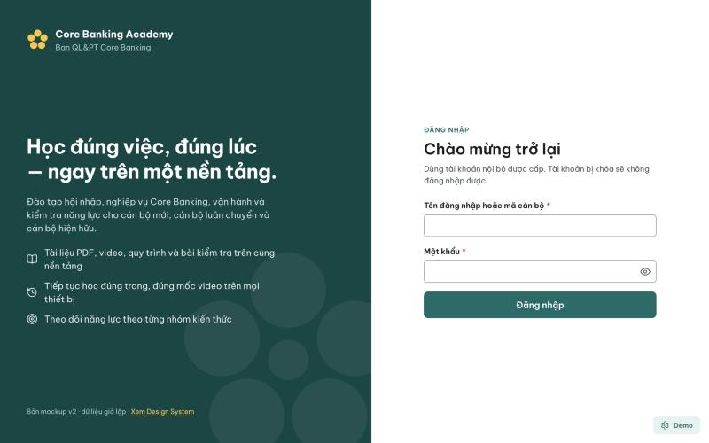

**02.** Khung ứng dụng. Nhóm menu viết hoa, sọc vàng ở mục đang chọn, trang placeholder với vòng tròn icon căn giữa, 2 toast có sọc trái cho cùng một lần đăng nhập.

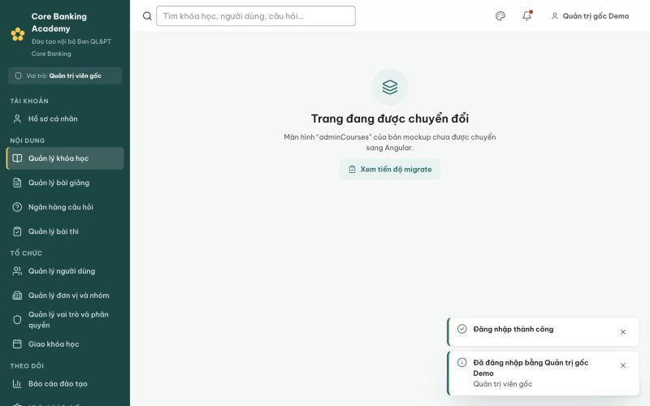

**03.** Bảng người dùng. Eyebrow "TỔ CHỨC" lặp lại nhóm menu, tiêu đề cột viết hoa, pill vai trò và pill trạng thái, link đỏ "Khóa" trên mỗi dòng, dòng cao vì tên đơn vị xuống 5 dòng.

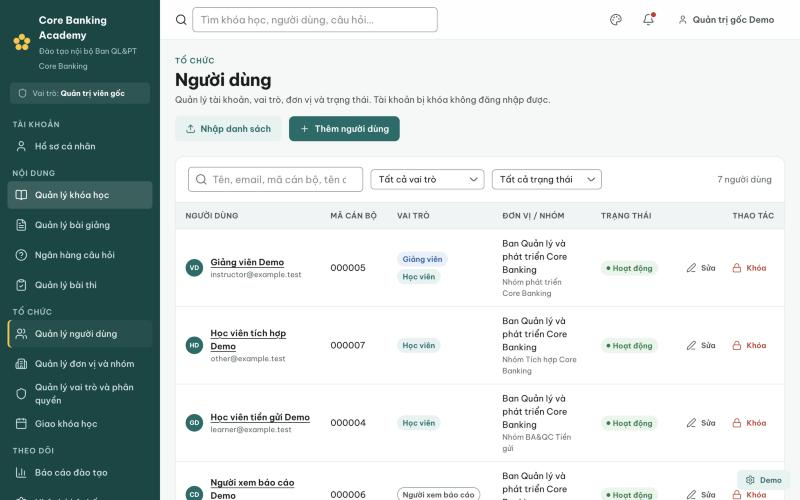

**04.** Hồ sơ, BIDV chuẩn. 4 badge trên một dòng (vai trò màu đỏ), 13 chip quyền.

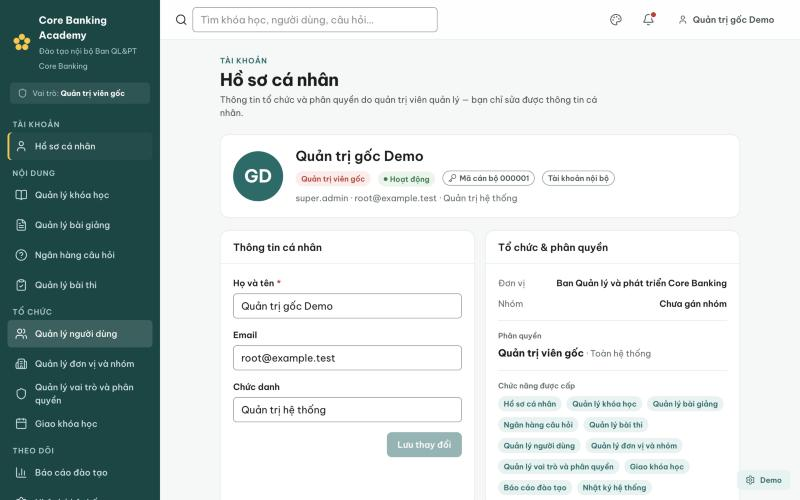

**05.** Hồ sơ, Giấy. Cùng giải phẫu như ảnh 04. Tiêu đề thẻ nhỏ cũng dùng serif, nền có lưới chấm.

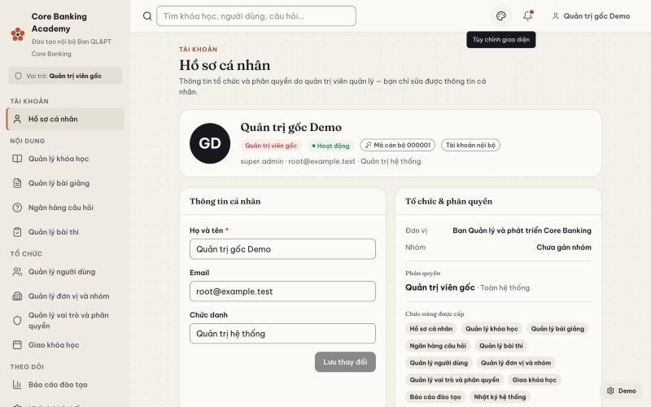

**06.** `/design-system`: hero gradient có bông mai mờ, chip tự khen, lưới 6 thẻ nguyên tắc với icon trong ô.

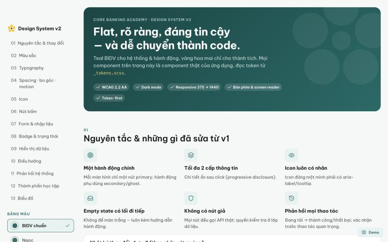

**07.** Badge và thẻ. Nhiều màu badge trên cùng một dòng, thẻ có nền màu.

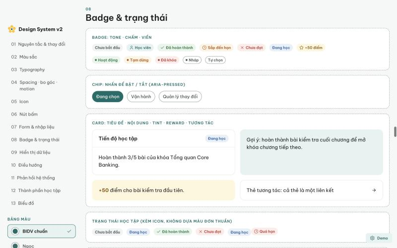

**08.** KPI với ô icon 44px, danh sách có ô icon, tiêu đề cột viết hoa.

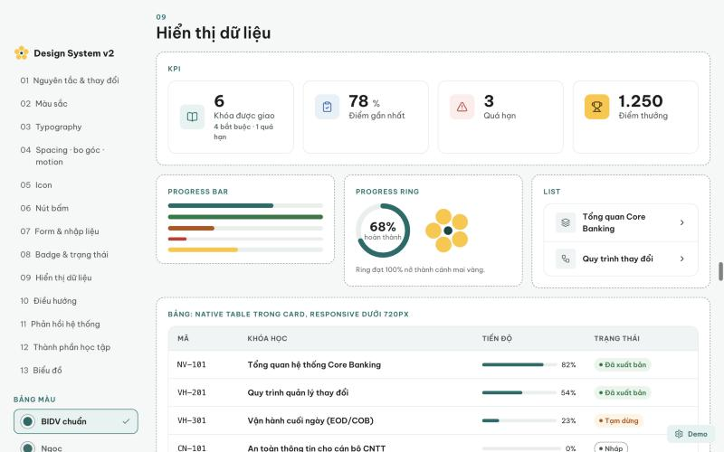

**09.** Alert có nền màu, hộp "Mẹo" có sọc vàng ở viền trái.

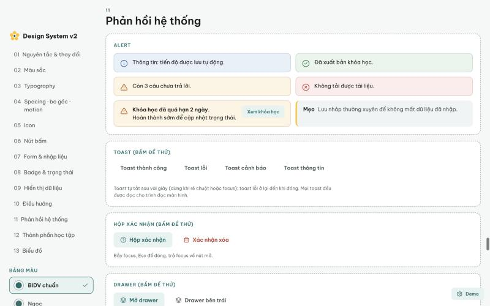

**10.** Ba empty state cùng một khuôn: vòng tròn icon, căn giữa, kèm nút.

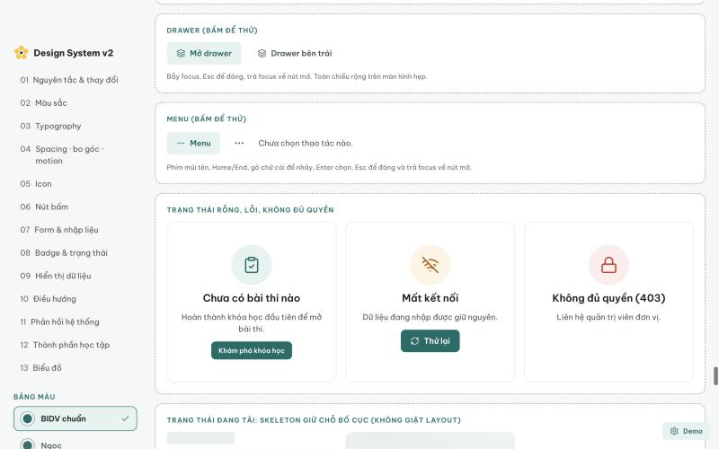

**11.** Thẻ khóa học: bìa pastel với icon ở giữa, badge đỏ "Bắt buộc", eyebrow, meta có icon.

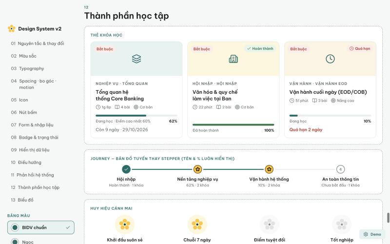

**12.** Hero ở bảng màu Cobalt: gradient xanh cobalt, tiêu đề độ đậm 300. Giải phẫu giữ nguyên.

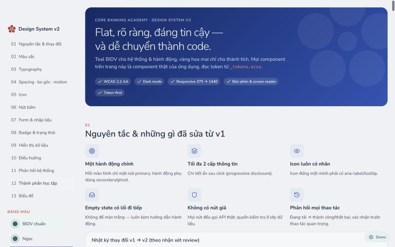

**13.** Hero ở bảng màu Giấy: nền gần đen, Fraunces, lưới chấm. Giải phẫu giữ nguyên.

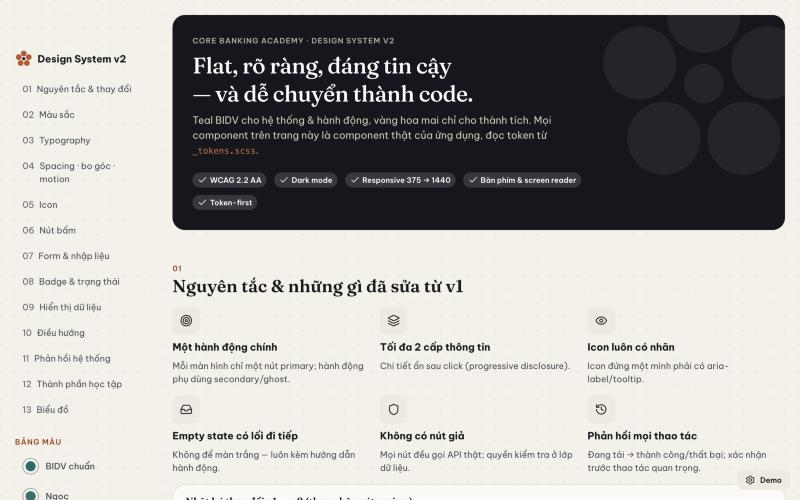

**14.** Thang chữ. Mô tả còn dòng "Skill gợi ý cặp 'Financial Trust'". Caption 12/600 viết hoa.

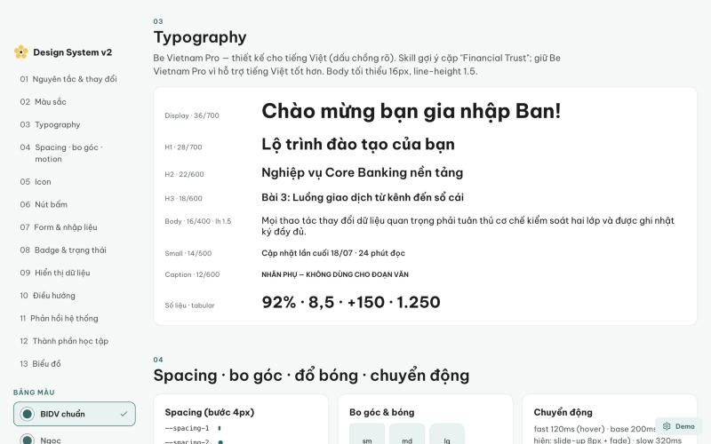
